# UBS-117: event publication and integration boundary

An event records something that happened. An alert records a rule deciding that
something needs attention. Events do not require an alert rule. Both are sanitised
derived telemetry; neither contains the original log message (ADR 0004).

## Sponsor review baseline (proposed; not yet approved)

This is the implemented UBS-117 baseline to confirm with the sponsor. The agent
**pushes** selected observations to the backend; a reader can **pull** stored
events from the backend API. An event is an observation, while an alert is a
separate rule decision. Neither contains the original log message.

Follow one input through the system:

1. The simulator writes `Application.log` (main, client and venue messages) and
   `Fix.log`. The agent's log monitor tails the configured files. Future host or
   process detectors would be additional inputs, not another event pipeline.
2. The parser classifies a line. An application line has a severity of N, I, W,
   E or F and may match a configured signature. FIX messages have their own
   session/order classification.
3. The metrics ingestor counts **every** application line by severity. It also
   counts E/F errors and every configured signature match. Thus N/I/W are not
   discarded simply because they do not become individual events.
4. The event emitter selects publishable observations: configured signature
   matches at **any** severity; separate E/F count summaries per 10-second
   bucket, including unmatched errors; selected FIX, monitor, agent and callback
   conditions. Unmatched N/I/W lines are metrics only. These are derived,
   bounded events, not a raw-log stream.
5. In parallel, the existing rule engine decides whether a matching condition
   warrants an alert. An event needs no alert rule. Alert fired/resolved
   transitions themselves become events; event publication does not create an
   alert or callback.
6. The publisher batches events with existing telemetry, sends them to the
   backend, and the existing EventStore exposes them via `GET /telemetry/events`.
   This store is bounded and in-memory, so events are queryable while retained,
   not guaranteed permanent history. The current natural-language query service
   reads metrics and alerts, **not** EventStore; MCP/NL event access is later
   integration work.

For example, a venue `[W] ... failed to complete connection` line increments
the W-line and matching-signature counters and publishes an
`app.error_signature` warning event. It does **not** raise an alert unless a
corresponding rule exists. An `[E] ... timed out` line additionally contributes
to an E-level `app.error` summary. An F line produces a critical signature
event if it matches, plus an F summary, but a generic F-level alert awaits
UBS-128. Venue signatures remain configured so their named classifications are
queryable; event fields currently do not identify BSE/LSE or the venue session.

Sponsor decisions to confirm before expanding this baseline:

- Are severity counts for all N/I/W/E/F, signature events at any level, and
  aggregate E/F events sufficient, or is a per-line event required for every
  unmatched N/I/W message? The latter would change volume and retention.
- Do event queries need the specific venue/session identity, rather than just
  the connection-problem signature? That would require a reviewed field schema.
- Which conditions should become alerts or notifications, as distinct from
  queryable observations? Disk/memory and process-down detection, a generic
  F-level alert, MCP access and Teams delivery remain in their separate tickets.

`app.error` extends the earlier ticket comment that proposed only alert
transitions for application failures. Publishing unknown E/F counts meets the
sponsor's observation request without taking over UBS-128's alert decision or
adding another processing pipeline.

## Architecture comparison

The **same name means the same responsibility** in both diagrams. Telemetry
Agent and Telemetry Backend Service are the deployable services; the other
boxes are components inside them, not additional deployments. “Parser Engine”
means the parser registry and FIX/application parsers. “Query Service” means
the backend's query API routes, and “NL Adapter” is the current `NlQueryService`.

### Current: implemented UBS-117 baseline

The agent has one outbound Backend Publisher. Parsed results go to the Metrics
Ingestor, which updates the Metrics Aggregator and separately calls the Event
Emitter. The Snapshot Emitter reads completed metric buckets; the Event Emitter
does **not** consume snapshots.

```mermaid
flowchart LR
    Logs[Application.log / Fix.log]
    subgraph Agent[Telemetry Agent]
        Monitor[Log Monitor] --> Parser[Parser Engine] --> Ingestor[Metrics Ingestor]
        Ingestor --> Aggregator[Metrics Aggregator]
        Ingestor --> Events[Event Emitter]
        Monitor --> Events
        Aggregator --> Rules[Rule Engine]
        Aggregator --> Snapshots[Snapshot Emitter]
        Rules --> Router[Alert Router]
        Router --> Callbacks[Callback Dispatcher]
        Router --> Events
        Callbacks --> Events
        Router --> Publisher[Backend Publisher]
        Events --> Publisher
        Snapshots --> Publisher
        Health[Health Reporter] --> Publisher
    end
    subgraph Backend[Telemetry Backend Service]
        Ingestion[Ingestion Service] --> Stream[Stream Processor] --> Metrics[Metric Store]
        Ingestion --> EventStore[Event Store]
        Ingestion --> AlertStore[Alert Store]
        Ingestion --> Registry[Agent Registry] --> Heartbeats[Heartbeat Monitor] --> AlertStore
        Metrics --> Query[Query Service]
        EventStore --> Query
        AlertStore --> Query
        Metrics --> NL[NL Adapter]
        AlertStore --> NL
    end
    Logs --> Monitor
    Publisher -->|POST /telemetry/batch| Ingestion
    Query --> API[API clients]
    NL --> API
```



The current NL Adapter reads metrics and alerts, **not** the Event Store. The
Query Service already exposes Event Store data through `GET /telemetry/events`.
The Agent Registry/Heartbeat Monitor branch represents the batch heartbeat
handling and backend missing-heartbeat check, not a second publisher.

### Intended to-be: same services, with planned additions

The existing boxes retain exactly the same names and roles. The Host Monitor
adds host gauges to the existing metric/rule path; host alert transitions then
follow the same Alert Router and Event Emitter path. The MCP Server and Teams
surfaces **read** backend APIs; they do not receive the agent's ingest batches.

```mermaid
flowchart LR
    Logs[Application.log / Fix.log]
    subgraph Agent[Telemetry Agent]
        Monitor[Log Monitor] --> Parser[Parser Engine] --> Ingestor[Metrics Ingestor]
        Ingestor --> Aggregator[Metrics Aggregator]
        Ingestor --> Events[Event Emitter]
        Monitor --> Events
        Host[Host Monitor] --> Aggregator
        Aggregator --> Rules[Rule Engine]
        Aggregator --> Snapshots[Snapshot Emitter]
        Rules --> Router[Alert Router]
        Router --> Callbacks[Callback Dispatcher]
        Router --> Events
        Callbacks --> Events
        Router --> Publisher[Backend Publisher]
        Events --> Publisher
        Snapshots --> Publisher
        Health[Health Reporter] --> Publisher
    end
    subgraph Backend[Telemetry Backend Service]
        Ingestion[Ingestion Service] --> Stream[Stream Processor] --> Metrics[Metric Store]
        Ingestion --> EventStore[Event Store]
        Ingestion --> AlertStore[Alert Store]
        Ingestion --> Registry[Agent Registry] --> Heartbeats[Heartbeat Monitor] --> AlertStore
        Metrics --> Query[Query Service]
        EventStore --> Query
        AlertStore --> Query
        Metrics --> NL[NL Adapter]
        AlertStore --> NL
        EventStore -.->|event-aware NL, proposed| NL
    end
    Logs --> Monitor
    Publisher -->|POST /telemetry/batch| Ingestion
    Query --> API[API clients]
    NL --> API
    Query -->|read-only backend APIs| MCP[MCP Server] --> Copilot[Microsoft 365 Copilot]
    NL -->|/telemetry/nl/query| Teams[Teams Bot] --> Users[Internal users]
    Copilot --> Users
    AlertStore -.->|delivery design pending| Notifications[Teams Notifications] -.-> Users
```



Host Monitor, MCP Server, Copilot/Teams integration, Teams Notifications and
the dashed event-aware NL/notification links are future work. Their exact
delivery and query contracts need their own tickets and sponsor confirmation;
this diagram does not claim they are implemented by UBS-117.

## Implemented in this change

The configured agent sends a `TelemetryBatch` to `POST /telemetry/batch`,
including events, snapshots, alerts and a heartbeat. It does **not** call
`POST /telemetry/events`; that is an event-only convenience endpoint for other
callers and uses the same backend EventStore. `GET /telemetry/events` is a read
endpoint, not a publishing path. Unlike the batch endpoint, the event-only POST
does not apply batch-ID deduplication or the batch request rate limiter.

The existing HTTP batches now carry:

- FIX logon/logout, latched heartbeat timeout, sequence gap/regression, order and
  session rejects, and sampled trade executions (one in 100 by default).
- `app.error` summaries: counts of E and F lines, separately, per 10-second bucket.
  These include unclassified errors. Unmatched N/I/W lines remain metric counts.
- `app.error_signature`: configured matches at any N/I/W/E/F level, independently
  of alert rules. N/I use `info`, W/E use `warning`, F uses `critical` severity.
- Aggregated `parse.error` reasons, without error details or source text.
- `agent.started` and `agent.stopping` during actual runtime start/clean shutdown.
- `agent.state_reset` on startup with missing, corrupt or unreadable offset state.
- `log.rotated`, `log.truncated` and `log.stalled` from the existing file monitor.
  Stalls emit once per idle episode and rearm after a complete line is read.
- `callback.failed` after a permanent HTTP failure, exhausted retries or oversized
  payload. Transient retries that recover do not emit failure events. This only
  publishes an observation; it never creates another callback.
- `alert.fired` and `alert.resolved`, referencing the existing alert ID and rule.
  Severity changes are observations of the same incident. Reminder notifications
  are suppressed in the event mirror using a bounded 4096-ID cache.

`app.error` severity labels describe the observation. Only RuleEngine decides to
fire an alert; the error summaries do not trigger callbacks. A matching signature,
an error summary and an alert transition are different views of the same activity,
not three errors. Use metrics for totals and alert IDs for incident counts.

The backend already stores and exposes events (UBS-118). This change reuses that
store and its `GET /telemetry/events` query; it only shares/extends the field allowlist
for derived operational metadata. UUIDv7 IDs survive retries. Events have the
existing bounded, in-memory retention and can be dropped during sustained overload
or outage; they are not a durable audit log.

Two pre-existing transport gaps remain outside UBS-117: the backend does not yet
enforce authentication on ingestion or event queries, and the publisher
rebuilds a new batch ID for a retry. Event IDs are retained across retries and
deduplicated by EventStore while retained, but an accepted batch whose response
is lost could have its metric snapshots merged twice on retry. Neither route
should be presented as production-ready until these are resolved.

Event batches also exposed a transport compatibility gap: the agent already
gzips bodies over 4 KiB, but the backend did not decode them. Ingestion now accepts
gzip and enforces `ingest.maxBodyBytes` (8 MiB by default) on wire/decoded bytes.
This closes a missing acceptance criterion of the already-Done UBS-85; its existing
dedupe and per-agent request limiter are reused. The full agent
burst test waits for the post-drain heartbeat: a queue full of real events can
truthfully report degraded health during the burst, then recover on the next publish.

## Config

Optional keys under the existing `publish:` section of agent.yaml:

```yaml
maxEventsPerMinute: 600     # per event type, per instance; rolling 60 seconds
executionSampleEvery: 100  # metrics still count every execution
```

Summary width uses the existing `publish.metricsBucketSeconds` (default 10).
These are observation-time summaries: a backlogged line processed after its
read-time bucket closed contributes to the active processing bucket. Original
application timestamp text is not transmitted. Metric counters keep their existing
read-time bucketing; query metrics when exact bucket counts matter. Application
signature/summary events report `timeSource: agent` because they use read/processing
time rather than a parsed application timestamp.
No rules.yaml or rules/defaults.py change is required for event publication.
Existing configured error signatures continue to apply. No new simulator log file
or log format is needed.

Optional `logs.logStallThreshold: 5m` in the current runtime mapping sets the idle
threshold for each monitored file. `sourceIndex` in log events is the zero-based
monitor order (configured file order); no path or source text is sent.

Offset-reset reporting preserves the existing restart policy: missing/corrupt
state falls back to offset zero, potentially replaying retained logs. The spec 002
FR-LOG-022 end-of-file fallback is **not** implemented by this change. Changing
that policy needs a separate log-monitor follow-up because it can skip data.

## Other work remains separate

| Responsibility | Owner / status |
| --- | --- |
| Automatically alert on any F line | UBS-128; not implemented here |
| Sample disk/memory and raise threshold alerts | UBS-129; not implemented here |
| Detect Magic process down/up | UBS-130; not implemented here |
| Store/query accepted events | UBS-118; existing implementation reused |
| Read telemetry through MCP | UBS-131; To Do; backend API adapter |
| Copilot/Teams query surfaces | UBS-100; To Do |
| Proactive Teams notifications on alert transitions | UBS-120; To Do |
| Surface callback delivery audit in NL answers/cards | UBS-102; To Do; separate from emitting callback.failed |

UBS-117/128/129/130/131/118/85 were rechecked on 2026-10-19: UBS-128/129/130/131
remain To Do; UBS-118 and UBS-85 are Done. Other rows were checked on 2026-10-18.
No Jira changes were made. No dedicated ticket was confirmed for the offset-recovery
policy mismatch. Individual unmatched N/I/W events and raw-log search are outside
the low-volume event contract (FR-MET-020).

Future host/application rules use the existing RuleEngine -> AlertRouter path;
their transitions automatically get event mirrors. They must not build a second
publisher, store or duplicate generic error detector. The detector must exist
before its events can be emitted: wiring alone does not detect a full disk.

MCP is a read-only backend API adapter. The telemetry agent **pushes** observations
to the backend; the future AI agent **pulls** them through MCP. The current NL service
queries metrics and alerts, not EventStore. UBS-131's `list_events` tool will expose
the existing event API; adding NL event intents remains integration work. This does not implement
unsolicited Teams/Copilot notifications. A dead host cannot publish its own death;
backend missing-heartbeat detection reports loss of contact, not proof of host death.

## Why the supporting changes remain

The publisher buffer lock protects concurrent parser-thread/event-loop access.
The shared allowlist keeps producer and backend field-key validation aligned;
producers explicitly select sanitised values rather than copying raw parser objects.
Gzip handling is required by the already-compressing publisher, and the body-size
cap closes a gap in the completed UBS-85. UBS-118's store/query implementation is
reused. No rule definitions, host/process samplers, new store, MCP server or Teams
notifications are added here. Shutdown publication remains best effort through
the existing final batch; overload/outages can still drop observations.

## Verification

`test_UBS_117_event_publication.py` writes real files and exercises the configured
monitor/parser, rule engine, callbacks, HTTP batch ingestion and event queries.
Unit tests cover aggregation, sampling, rate limits, UUIDs, retry identity, metadata
allowlists, reminder suppression and buffer concurrency. Existing UBS-121/122 tests
continue to cover simulator ingestion and signature rule isolation.
